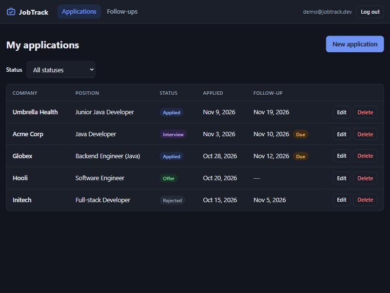
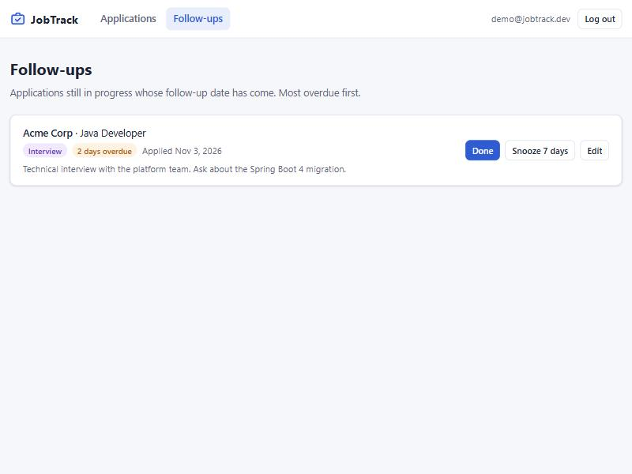
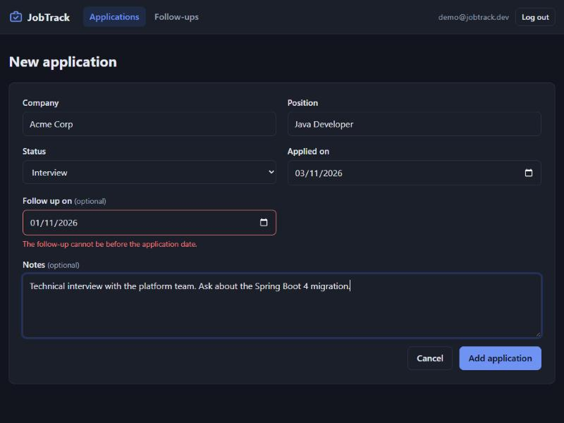

# JobTrack

Web application for tracking job applications: companies, positions, status,
follow-up reminders and notes.

> Portfolio project, built step by step during the *Concepteur Développeur
> d'Applications* training (ENI).



| Follow-ups due today or overdue | Form validation |
|---|---|
|  |  |

## Features

- Account registration and login (JWT), each user only sees their own data
- Create, edit and delete job applications: company, position, status,
  application date, follow-up date, notes
- Filter by status (the filter is kept in the URL)
- Follow-ups screen: active applications whose follow-up date has come,
  most overdue first, with *Done* and *Snooze 7 days* actions
- Responsive layout, light and dark themes

## Stack

| Layer      | Technology                                             |
|------------|--------------------------------------------------------|
| Backend    | Java 21, Spring Boot 3.5, Maven, Spring Data JPA       |
| Security   | Spring Security, stateless JWT authentication          |
| Database   | PostgreSQL 17 (Docker), Flyway migrations              |
| Frontend   | Angular 22 (standalone, signals), reactive forms       |
| Tests      | JUnit 5, Mockito, MockMvc, Testcontainers, JaCoCo, Vitest |
| DevOps     | Docker Compose, GitHub Actions                         |

## Roadmap

- [x] 1. Project skeleton: Spring Boot API, PostgreSQL via Docker Compose
- [x] 2. Domain model: `User` and `JobApplication` entities, Flyway migrations
- [x] 3. Applications CRUD: controller / service / repository layers, DTOs, validation
- [x] 4. Error handling: centralized `@RestControllerAdvice`, RFC 7807 problem details
- [x] 5. Status filter and follow-ups list
- [x] 6. Security: registration, login, JWT, per-user data isolation
- [x] 7. Test hardening: tests on real PostgreSQL (Testcontainers), JaCoCo coverage
- [x] 8. Angular frontend
- [x] 9. Full Docker Compose stack
- [x] 10. CI with GitHub Actions

Design choices and trade-offs are recorded in [docs/decisions.md](docs/decisions.md).

## Run with Docker (quickest)

Requirements: Docker only.

```bash
cp backend/.env.example backend/.env    # then set JWT_SECRET (openssl rand -base64 32)
docker compose up -d --build            # open http://localhost:8000
```

```
browser ──► nginx :8000 ──┬── Angular static files
                          └── /api ──► Spring Boot API ──► PostgreSQL
```

Only nginx is published. The API is reachable only through nginx, and
PostgreSQL only from this machine. Both application containers run as
non-root users.

## Run for development

Requirements: JDK 21+, Node.js 22+, Docker. Maven does not need to be installed:
the project ships the Maven Wrapper (`mvnw`).

```bash
docker compose up -d db       # start PostgreSQL only
cd backend
cp .env.example .env          # then set JWT_SECRET (openssl rand -base64 32)
./mvnw spring-boot:run        # start the API on http://localhost:8080
```

In a second terminal:

```bash
cd frontend
npm install
npm start                     # open http://localhost:4200
```

The API refuses to start without `JWT_SECRET`. In production, provide it (and
`DB_URL`, `DB_USERNAME`, `DB_PASSWORD`) as environment variables.

Health check: `http://localhost:8080/actuator/health`

Run the tests and the coverage check (Docker must be running: database tests
start a throwaway PostgreSQL container with Testcontainers):

```bash
cd backend
./mvnw verify
```

The coverage report is written to `backend/target/site/jacoco/index.html`;
the build fails below 90% line coverage.

| Test type          | Tools                        | Scope                                   |
|--------------------|------------------------------|-----------------------------------------|
| Unit               | JUnit 5, Mockito             | Services and validators, no Spring      |
| Web slice          | `@WebMvcTest`, MockMvc       | HTTP contract, validation, error format |
| Repository         | `@DataJpaTest`, PostgreSQL   | Queries, constraints, mappings          |
| Integration        | `@SpringBootTest`, PostgreSQL| Full stack including JWT security       |

## API

| Method | Path                             | Description                                         | Success |
|--------|----------------------------------|-----------------------------------------------------|---------|
| POST   | `/api/auth/register`             | Create an account, returns a token                  | 201     |
| POST   | `/api/auth/login`                | Log in, returns a token                             | 200     |
| GET    | `/api/applications`              | List my applications (optional `?status=`)          | 200     |
| GET    | `/api/applications/follow-ups`   | Follow-ups due today or overdue, active only        | 200     |
| GET    | `/api/applications/{id}`         | Get one application                                 | 200     |
| POST   | `/api/applications`              | Create an application                               | 201     |
| PUT    | `/api/applications/{id}`         | Replace an application                              | 200     |
| DELETE | `/api/applications/{id}`         | Delete an application                               | 204     |

Every `/api/applications` route requires `Authorization: Bearer <accessToken>`.
Tokens are valid for one hour:

```json
{ "accessToken": "eyJhbGciOiJIUzI1NiJ9...", "tokenType": "Bearer", "expiresIn": 3600 }
```

Errors follow [RFC 7807](https://www.rfc-editor.org/rfc/rfc7807)
(`application/problem+json`). Validation errors list each invalid field:

```json
{
  "type": "about:blank",
  "title": "Validation failed",
  "status": 400,
  "detail": "One or more fields are invalid.",
  "instance": "/api/applications",
  "errors": [
    { "field": "company", "message": "must not be blank" },
    { "field": "followUpOn", "message": "must not be before appliedOn" }
  ]
}
```

## Continuous integration

Every push and pull request runs [the CI pipeline](.github/workflows/ci.yml):

| Job      | What it checks                                                          |
|----------|-------------------------------------------------------------------------|
| Backend  | `mvnw verify`: all tests on PostgreSQL (Testcontainers), 90% coverage gate, coverage report as artifact |
| Frontend | `npm ci`, unit tests (Vitest), production build                         |
| Docker   | Runs after both: builds the images, starts the full stack, runs [an end-to-end smoke test](scripts/smoke-test.sh) through nginx |

Dependabot opens weekly update pull requests (Maven, npm, Docker images,
GitHub Actions), each one checked by the same pipeline.

## Troubleshooting

**Windows: `Unable to establish loopback connection` at startup.** Java NIO
creates a Unix domain socket in the temp folder, which fails when the Windows
user name contains non-ASCII characters (e.g. `é`). Point it to an ASCII folder:

```powershell
setx JDK_JAVA_OPTIONS "-Djdk.net.unixdomain.tmpdir=C:\Temp"
```
